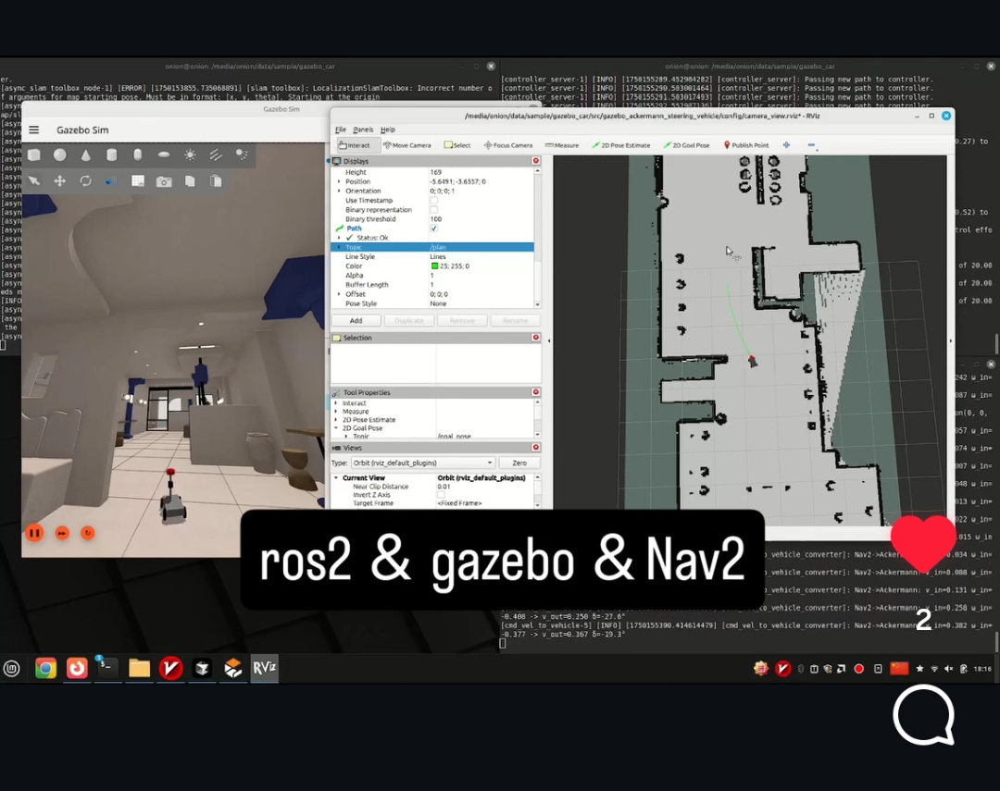

# Enhanced Gazebo Ackermann Vehicle with Nav2 Navigation

## 🚗 About

This project is an enhanced version of the Ackermann steering vehicle simulation, based on [lucasmazzetto/gazebo_ackermann_steering_vehicle](https://github.com/lucasmazzetto/gazebo_ackermann_steering_vehicle.git). The original repository provides an excellent foundation for Ackermann vehicle simulation using ROS 2 Jazzy Jalisco and Gazebo Harmonic.

**Key Enhancements:**
- ✅ **Improved U-turn capabilities** - Modified vehicle control algorithms for better 180°+ maneuvers
- ✅ **Nav2 integration** - Full autonomous navigation stack with MPPI controller
- ✅ **Enhanced cmd_vel conversion** - Optimized twist-to-Ackermann conversion for complex maneuvers
- ✅ **Keyboard control interface** - Direct manual control for testing and debugging
- ✅ **Custom navigation parameters** - Fine-tuned for Ackermann vehicle constraints
- ✅ **SLAM integration** - Ready-to-use mapping and localization

## Simulation Preview / 仿真演示



Gazebo shows the simulated vehicle and environment on the left; RViz2 shows the map and navigation path on the right. This is a screenshot of the simulation.

左侧为 Gazebo 中的车辆与场景，右侧为 RViz2 中的地图和导航路径。该画面为仿真截图。

## 🎯 Main Improvements

### 1. **Enhanced Vehicle Control**
- Modified `cmd_vel_to_vehicle.py` with improved algorithms for handling low-speed turning
- Better support for reverse maneuvers during U-turns
- Optimized steering angle calculations for tight spaces

### 2. **Nav2 Navigation Stack**
- Integrated SMAC Hybrid A* planner with Reeds-Shepp motion model
- MPPI controller configured for Ackermann constraints
- Reduced penalties for reverse movements to enable U-turns
- Custom costmap configurations

### 3. **User-Friendly Controls**
- Keyboard control script for manual vehicle operation
- Streamlined launch scripts with camera visualization
- RViz2 integration for path planning visualization

## 📚 Requirements

**Base Requirements (from original repo):**
- Linux Ubuntu 24.04
- ROS2 Jazzy Jalisco  
- Gazebo Harmonic

**Additional Dependencies:**
```bash
sudo apt install -y \
    ros-jazzy-nav2-bringup \
    ros-jazzy-nav2-mppi-controller \
    ros-jazzy-nav2-smac-planner \
    ros-jazzy-slam-toolbox \
    ros-jazzy-navigation2
```

## 🛠️ Setup

### Clone the Repository
```bash
cd <your_workspace>/src
git clone https://github.com/LiWeny16/ros2_jazzy_gazebo_ackermann_nav2_auto_driving.git
cd ..
```

### Build the Package
```bash
source /opt/ros/jazzy/setup.bash
colcon build
source install/setup.bash
```

## 🚀 Usage

### 1. **Launch Vehicle Simulation**
```bash
./launch_with_camera.sh
```
This script starts:
- Gazebo simulation with the Ackermann vehicle
- RViz2 with camera visualization
- Vehicle control interfaces

### 2. **Manual Control**
```bash
# In a new terminal
python3 keyboard_control.py
```

**Controls:**
- `W/S`: Forward/Backward
- `A/D`: Left/Right steering  
- `Space`: Stop all movement
- `Q`: Quit

### 3. **Navigation with Nav2**
```bash
# Start SLAM (if mapping)
ros2 launch slam_toolbox online_async_launch.py \
    slam_params_file:=src/gazebo_ackermann_steering_vehicle/config/slam.yaml \
    use_sim_time:=true

# Start Navigation
ros2 launch nav2_bringup navigation_launch.py \
    use_sim_time:=true \
    map:=src/gazebo_ackermann_steering_vehicle/map/slam_map.yaml \
    params_file:=src/gazebo_ackermann_steering_vehicle/config/nav2_params.yaml
```

### 4. **Visualize Navigation in RViz2**

Add these display types in RViz2:
- **Path** - Topic: `/plan` (Global path)
- **Path** - Topic: `/local_plan` (Local path)  
- **MarkerArray** - Topic: `/FollowPath/trajectories` (MPPI trajectories)
- **Map** - Topic: `/map`
- **LaserScan** - Topic: `/scan`
- **Costmap** - Topics: `/local_costmap/costmap` and `/global_costmap/costmap`

## 🔧 Key Modifications

### Navigation Parameters (`config/nav2_params.yaml`)
- **SMAC Planner**: `reverse_penalty: 0.3` (reduced from 1.0)
- **MPPI Controller**: `PreferForwardCritic` weight reduced to 1.0
- **Motion Model**: Configured for Reeds-Shepp with reverse maneuvers

### Vehicle Control (`src/cmd_vel_to_vehicle.py`)
- Enhanced conversion algorithm for low-speed turning
- Improved handling of pure rotation commands
- Better speed management during tight maneuvers

## 📊 Performance Improvements

| Feature | Original | Enhanced |
|---------|----------|----------|
| U-turn capability | Limited | ✅ Full 180°+ turns |
| Nav2 integration | None | ✅ Complete stack |
| Manual control | Joystick only | ✅ Keyboard + Joystick |
| Path planning | Basic | ✅ Advanced hybrid A* |
| Visualization | Basic | ✅ Full RViz2 setup |

## 🙏 Acknowledgments

This project builds upon the excellent work by [Lucas Mazzetto](https://github.com/lucasmazzetto) in the [gazebo_ackermann_steering_vehicle](https://github.com/lucasmazzetto/gazebo_ackermann_steering_vehicle.git) repository. The original implementation provides a solid foundation for Ackermann vehicle simulation in ROS 2.

**Original Features Retained:**
- Vehicle modeling and URDF definitions
- Gazebo integration and physics simulation  
- Camera sensor integration
- Basic vehicle control interfaces
- Docker support for consistent environments

## 📝 License

This project maintains the same license as the original repository (Apache License 2.0).

## 🔗 Links

- **Original Repository**: [gazebo_ackermann_steering_vehicle](https://github.com/lucasmazzetto/gazebo_ackermann_steering_vehicle.git)
- **Original Documentation**: [Ackermann Steering Vehicle Simulation Guide](https://workabotic.com/2025/ackermann-steering-vehicle-simulation/)
- **ROS 2 Jazzy Documentation**: [docs.ros.org](https://docs.ros.org/en/jazzy/)
- **Nav2 Documentation**: [navigation.ros.org](https://navigation.ros.org/)

## 🐛 Known Issues

- Large turning maneuvers may require multiple attempts in tight spaces
- MPPI visualization works best with `visualize: true` in nav2_params.yaml
- First-time navigation may take longer to initialize

## 🤝 Contributing

Contributions are welcome! Please feel free to submit issues, feature requests, or pull requests to improve the vehicle's navigation capabilities.
